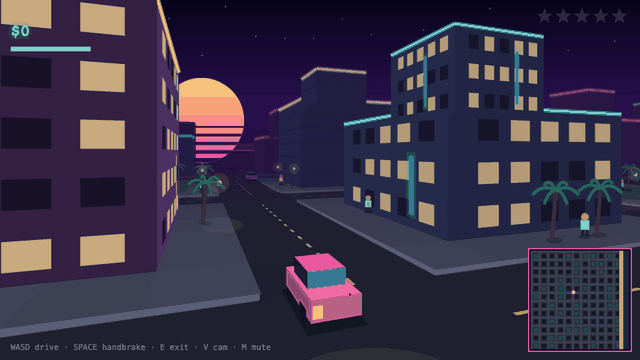
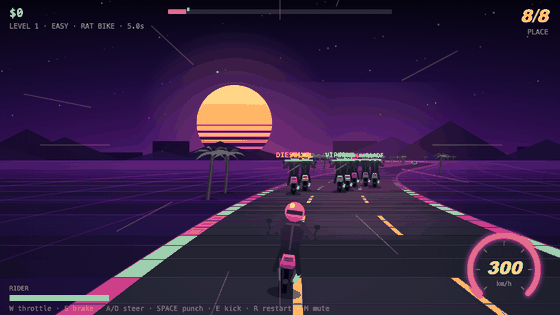

# Playground

50 games, tools, and toys that run straight in the browser. Plain HTML, CSS, and JavaScript: no frameworks, no build step, nothing to install.

Live at https://rajeshrenato.github.io/playground/

MIT licensed. Issues and pull requests are welcome, see [CONTRIBUTING.md](CONTRIBUTING.md).

## Highlights

### [Vice City](vicecity/)



Open-world driving in a procedural city with traffic AI, police chases, and delivery jobs. The street-level 3D camera is drawn on a plain 2D canvas, with a top-down view one key away.

[Play Vice City](https://rajeshrenato.github.io/playground/vicecity/)

### [Breach](breach/)


First-person shooter on a raycasting engine written from scratch. Every wall texture, sprite, and sound effect is generated in code at startup.

[Play Breach](https://rajeshrenato.github.io/playground/breach/)

### [Road Rash](road-rash/)



Motorcycle combat racing on a pseudo-3D road. Punch and kick rivals, take their clubs, dodge two-way traffic, and spend your winnings on faster bikes. Three difficulty levels.

[Play Road Rash](https://rajeshrenato.github.io/playground/road-rash/)

### [Arrow Flux](arrow-flux/)


Slide tangled arrows off a packed board. The generator builds each board in solution order, so every puzzle is guaranteed solvable, from 6×8 up to 26×37.

[Play Arrow Flux](https://rajeshrenato.github.io/playground/arrow-flux/)

## Everything else

### Games

| Project | What it is |
| --- | --- |
| [dune-drift](dune-drift/) | One-button endless ride over rolling dunes; backflips at sunset |
| [pixel-logic](pixel-logic/) | Nonograms, solver-verified so pure deduction always wins |
| [glow-out](glow-out/) | Lights Out with hints computed from a live solution set |
| [flood-rush](flood-rush/) | Flood-fill the grid and beat a greedy bot's par |
| [labyrinth](labyrinth/) | Escape procedural mazes through fog of war |
| [grid-defense](grid-defense/) | Small tower defense against waves that keep scaling |
| [orbit-golf](orbit-golf/) | Nine holes of golf bent by gravity wells and repulsors |
| [stack-tower](stack-tower/) | One-button block stacking with overhang slicing |
| [arcade-tycoon](arcade-tycoon/) | Idle arcade empire that keeps earning while the tab is closed |
| [echo-grid](echo-grid/) | Simon-style audio memory with a strict mode |
| [flag-dash](flag-dash/) | A sixty-second flag quiz built entirely from emoji |
| [type-velocity](type-velocity/) | Typing test with live WPM and per-character feedback |
| [reflex-lab](reflex-lab/) | Reaction, aim, and choice-speed tests with ratings and bests |

### Classics

| Project | What it is |
| --- | --- |
| [coil](coil/) | Snake; speeds up as you grow, swipe to steer on a phone |
| [brickfall](brickfall/) | Brick-breaker with eight levels and angle-based paddle physics |
| [slide-2048](slide-2048/) | The sliding-tile game, by keyboard or swipe |
| [stackfall](stackfall/) | Falling tetrominoes with hold, ghost piece, and a 7-bag randomizer |
| [rockblaster](rockblaster/) | Asteroids-style shooter with splitting rocks and screen wrap |
| [minefield](minefield/) | Minesweeper with three difficulties, safe first click, and best times |
| [sudoku](sudoku/) | Sudoku from a generator that guarantees exactly one solution |
| [penta](penta/) | A five-letter word game with win streaks and emoji sharing |

### Tools

| Project | What it is |
| --- | --- |
| [json-studio](json-studio/) | Format, validate, and explore JSON in a collapsible tree, offline |
| [regex-playground](regex-playground/) | Regex tester with live highlighting, groups, and replace preview |
| [diff-deck](diff-deck/) | Side-by-side text diff with character-level highlighting |
| [csv-viewer](csv-viewer/) | Sort, filter, and export CSV or TSV; handles quoted fields |
| [jwt-peek](jwt-peek/) | Decode JWTs with expiry status; tokens never leave the page |
| [cron-sage](cron-sage/) | Cron expressions in plain English, with the next six run times |
| [bit-bench](bit-bench/) | 32-bit base converter with clickable bits and live bitwise ops |
| [markdown-pad](markdown-pad/) | Markdown editor with a hand-written parser and live preview |
| [unit-converter](unit-converter/) | Two-way conversion across eight categories |
| [key-forge](key-forge/) | Password and passphrase generator with an entropy meter |
| [time-overlap](time-overlap/) | Find the meeting hours that work across time zones |
| [focus-timer](focus-timer/) | Pomodoro timer with auto-cycling breaks and daily stats |
| [palette-lab](palette-lab/) | Color palette generator with locking, export, and shareable URLs |
| [pixel-forge](pixel-forge/) | Pixel-art editor with fill, undo, autosave, and PNG export |
| [beat-grid](beat-grid/) | A 16-step drum machine; the whole beat fits in the URL |
| [morse-coder](morse-coder/) | Morse translator with correctly timed audio and a trainer |
| [profile-banner](profile-banner/) | Animated SVG banner generator for a GitHub profile |

### Toys & simulations

| Project | What it is |
| --- | --- |
| [flowfield](flowfield/) | Particles tracing a procedural vector field; save the result as a PNG |
| [orbit-sandbox](orbit-sandbox/) | N-body gravity sandbox; sling planets around a star |
| [pendulum-chaos](pendulum-chaos/) | Twelve double pendulums diverging from near-identical starts |
| [boid-swarm](boid-swarm/) | Flocking simulation with tunable instincts; your cursor is the predator |
| [life-grid](life-grid/) | Conway's Game of Life with drawing and presets |
| [fractal-viewer](fractal-viewer/) | Mandelbrot and Julia explorer with click-to-zoom |
| [neuro-pilot](neuro-pilot/) | 120 small neural networks learning to fly by evolution |
| [sort-arena](sort-arena/) | Sorting algorithms racing on identical data, with op counters |

## Run locally

```bash
python3 -m http.server 8742
# visit http://localhost:8742
```

## Tests

Node 18 or newer, no packages:

```bash
node --test
```

## Contributing

See [CONTRIBUTING.md](CONTRIBUTING.md).

## License

[MIT](LICENSE)
