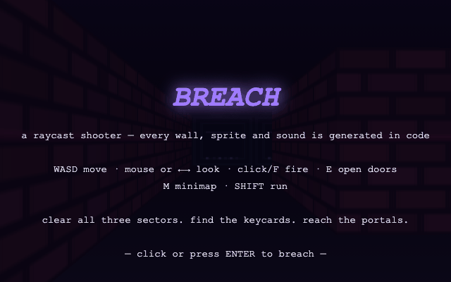
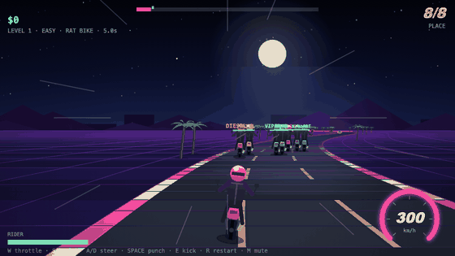
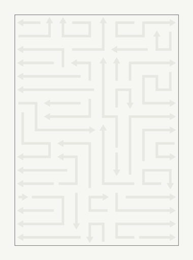

# Playground

72 games, tools, and toys that run straight in the browser. Plain HTML, CSS, and JavaScript: no frameworks, no build step, nothing to install.

Live at https://rajeshrenato.github.io/playground/

MIT licensed. Issues and pull requests are welcome, see [CONTRIBUTING.md](CONTRIBUTING.md).

New every day: [daily puzzles](daily/), with today's Penta, Sudoku, and Arrow Flux and one streak across all three.

Ten of these work online with friends and no server: [Cycle Duel](cycle-duel/), [Type Race](type-race/), [Sketch & Guess](sketch-guess/), [Four in a Row](four-in-a-row/), [Checkers](checkers/), [Chess](chess/), [Clue Grid](clue-grid/), [Ludo](ludo/), [Trivia Night](trivia-night/), and [Whiteboard](whiteboard/). Browsers connect directly through links, using a small kit you can reuse: [LinkPlay](linkplay/).

## Highlights

### [Miami Nights](miami-nights/)


A GTA Vice City-style open world: a procedural Miami with traffic AI, police chases, and delivery jobs. The street-level 3D camera is drawn on a plain 2D canvas, with a top-down view one key away.

[Play Miami Nights](https://rajeshrenato.github.io/playground/miami-nights/)

### [Breach](breach/)



First-person shooter on a raycasting engine written from scratch. Every wall texture, sprite, and sound effect is generated in code at startup.

[Play Breach](https://rajeshrenato.github.io/playground/breach/)

### [Midnight Racing](midnight-racing/)



Road Rash-style bike combat racing at midnight, on a pseudo-3D road. Punch and kick rivals, take their clubs, dodge two-way traffic, and spend your winnings on faster bikes. Share a link to your run and friends race your ghost.

[Play Midnight Racing](https://rajeshrenato.github.io/playground/midnight-racing/)

### [Arrow Flux](arrow-flux/)



Slide tangled arrows off a packed board. The generator builds each board in solution order, so every puzzle is guaranteed solvable, from 6×8 up to 26×37.

[Play Arrow Flux](https://rajeshrenato.github.io/playground/arrow-flux/)

## Everything else

### Play online

No server: browsers connect directly through links (see [LinkPlay](linkplay/)).

| Project | What it is |
| --- | --- |
| [cycle-duel](cycle-duel/) | Light-cycle duels. Play a friend online with just a link, on one keyboard, or against a bot |
| [type-race](type-race/) | Typing races with friends over a link, no server. Or race your own best pace |
| [sketch-guess](sketch-guess/) | Take turns drawing a word while friends guess it. Up to 8 players, connected by links |
| [four-in-a-row](four-in-a-row/) | Connect Four-style. Play a friend online with a link, on one screen, or against a bot |
| [checkers](checkers/) | Forced captures, multi-jumps, and kings. Play a friend online, on one screen, or against a bot |
| [chess](chess/) | Play chess with a friend online over a link, on one screen, or against a bot with three levels |
| [clue-grid](clue-grid/) | A Codenames-style word game for two teams. Spymasters give one-word clues. 4 to 8 players |
| [ludo](ludo/) | Ludo for 2 to 4. Play friends online with a link, pass one phone around, or play bots |
| [trivia-night](trivia-night/) | A trivia quiz for friends over a link. 320 questions in 8 categories, or play alone |
| [whiteboard](whiteboard/) | Draw, sketch shapes, and write notes together over a link. Save the board as a PNG |

### Games

| Project | What it is |
| --- | --- |
| [dune-drift](dune-drift/) | One-button endless ride over rolling dunes. Share a link and friends ride against your ghost |
| [pixel-logic](pixel-logic/) | Nonograms, solver-verified so pure deduction always wins |
| [glow-out](glow-out/) | Lights Out with hints computed from a live solution set |
| [flood-rush](flood-rush/) | Flood-fill the grid and beat a greedy bot's par |
| [labyrinth](labyrinth/) | Escape procedural mazes through fog of war |
| [grid-defense](grid-defense/) | Small tower defense against waves that keep scaling |
| [orbit-golf](orbit-golf/) | Nine holes of golf bent by gravity wells and repulsors |
| [stack-tower](stack-tower/) | One-button block stacking with overhang slicing |
| [arcade-tycoon](arcade-tycoon/) | Idle arcade empire that keeps earning while the tab is closed |
| [echo-grid](echo-grid/) | Simon-style audio memory with a strict mode |
| [flag-dash](flag-dash/) | A sixty-second flag quiz built entirely from emoji |
| [type-velocity](type-velocity/) | Typing test with live WPM and per-character feedback |
| [reflex-lab](reflex-lab/) | Reaction, aim, and choice-speed tests with ratings and bests |

### Classics

| Project | What it is |
| --- | --- |
| [coil](coil/) | Snake. It speeds up as you grow. Swipe to steer on a phone |
| [brickfall](brickfall/) | Brick-breaker with eight levels and angle-based paddle physics |
| [slide-2048](slide-2048/) | The sliding-tile game, by keyboard or swipe |
| [stackfall](stackfall/) | Falling tetrominoes with hold, ghost piece, and a 7-bag randomizer |
| [rockblaster](rockblaster/) | Asteroids-style shooter with splitting rocks and screen wrap |
| [minefield](minefield/) | Minesweeper with three difficulties, safe first click, and best times |
| [sudoku](sudoku/) | Sudoku from a generator that guarantees exactly one solution |
| [penta](penta/) | A five-letter word game with win streaks and emoji sharing |

### Tools

| Project | What it is |
| --- | --- |
| [pdf-toolkit](pdf-toolkit/) | Merge, split, reorder, rotate, and delete PDF pages. Everything stays on your device |
| [images-to-pdf](images-to-pdf/) | Turn photos and scans into one PDF, with JPEGs kept at full quality. Nothing is uploaded |
| [linkplay](linkplay/) | A small kit for making browser games multiplayer with links and no server. All the online games here use it |
| [file-send](file-send/) | Send files straight to a friend's browser. Nothing is uploaded |
| [secret-note](secret-note/) | Write a note and get a link with it encrypted inside. Nothing is stored |
| [secret-chat](secret-chat/) | A private chat between two browsers, no server. Hidden and disappearing messages, and a safety code |
| [qr-studio](qr-studio/) | QR codes for links, Wi-Fi, and contacts, with your colors and logo. No watermark |
| [photo-privacy](photo-privacy/) | See and remove the hidden location, date, and device details in photos |
| [image-squeeze](image-squeeze/) | Compress, resize, and convert images, or fit them under a size limit |
| [video-to-gif](video-to-gif/) | Trim a clip and turn it into a GIF, made on your device. No watermark |
| [screen-recorder](screen-recorder/) | Record your screen with your voice and a camera bubble. No install, no watermark |
| [json-studio](json-studio/) | Format, validate, and explore JSON in a collapsible tree, offline |
| [regex-playground](regex-playground/) | Regex tester with live highlighting, groups, and replace preview |
| [diff-deck](diff-deck/) | Side-by-side text diff with character-level highlighting |
| [csv-viewer](csv-viewer/) | Sort, filter, and export CSV or TSV files, quoted fields included |
| [jwt-peek](jwt-peek/) | Decode JWTs and check their expiry. Tokens never leave the page |
| [cron-sage](cron-sage/) | Cron expressions in plain English, with the next six run times |
| [bit-bench](bit-bench/) | 32-bit base converter with clickable bits and live bitwise ops |
| [markdown-pad](markdown-pad/) | Markdown editor with a hand-written parser and live preview |
| [unit-converter](unit-converter/) | Two-way conversion across eight categories |
| [key-forge](key-forge/) | Password and passphrase generator with an entropy meter |
| [time-overlap](time-overlap/) | Find the meeting hours that work across time zones |
| [focus-timer](focus-timer/) | Pomodoro timer with auto-cycling breaks and daily stats |
| [palette-lab](palette-lab/) | Color palette generator with locking, export, and shareable URLs |
| [pixel-forge](pixel-forge/) | Pixel-art editor with fill, undo, autosave, and PNG export |
| [beat-grid](beat-grid/) | A 16-step drum machine. The whole beat fits in the URL |
| [morse-coder](morse-coder/) | Morse translator with correctly timed audio and a trainer |
| [profile-banner](profile-banner/) | Animated SVG banner generator for a GitHub profile |

### Toys & simulations

| Project | What it is |
| --- | --- |
| [flowfield](flowfield/) | Particles tracing a procedural vector field. Save the result as a PNG |
| [orbit-sandbox](orbit-sandbox/) | An n-body gravity sandbox. Sling planets around a star |
| [pendulum-chaos](pendulum-chaos/) | Twelve double pendulums diverging from near-identical starts |
| [boid-swarm](boid-swarm/) | A flocking simulation with tunable instincts. Your cursor is the predator |
| [life-grid](life-grid/) | Conway's Game of Life with drawing and presets |
| [fractal-viewer](fractal-viewer/) | Mandelbrot and Julia explorer with click-to-zoom |
| [neuro-pilot](neuro-pilot/) | 120 small neural networks learning to fly by evolution |
| [falling-sand](falling-sand/) | Pour sand, water, oil, fire, lava, acid, and plants, and watch them react |
| [sort-arena](sort-arena/) | Sorting algorithms racing on identical data, with op counters |

## Run locally

```bash
python3 -m http.server 8742
# visit http://localhost:8742
```

## Tests

Node 18 or newer, no packages:

```bash
node --test
```

## Contributing

See [CONTRIBUTING.md](CONTRIBUTING.md).

## License

[MIT](LICENSE)
